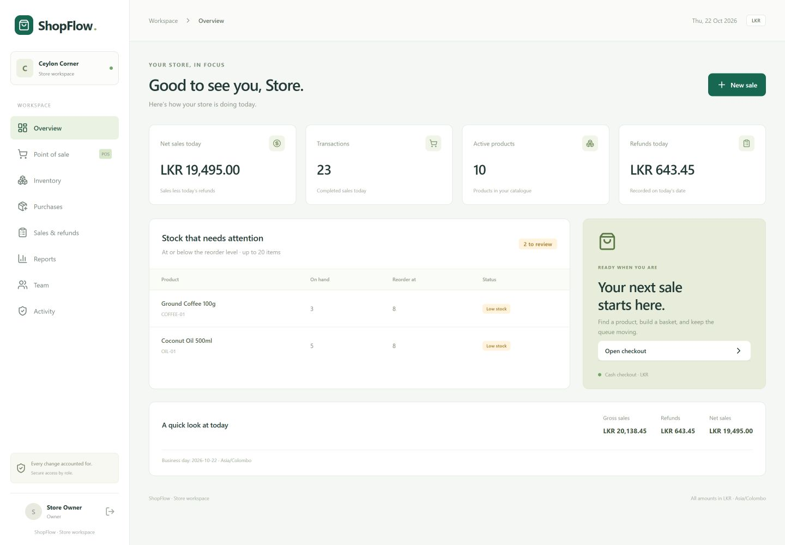
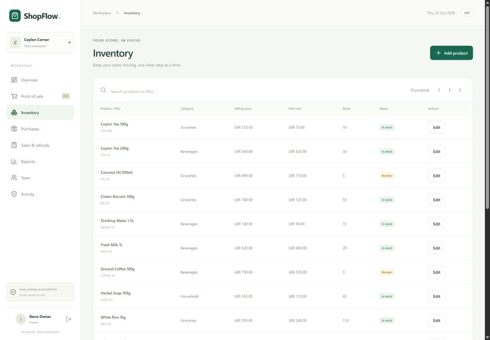
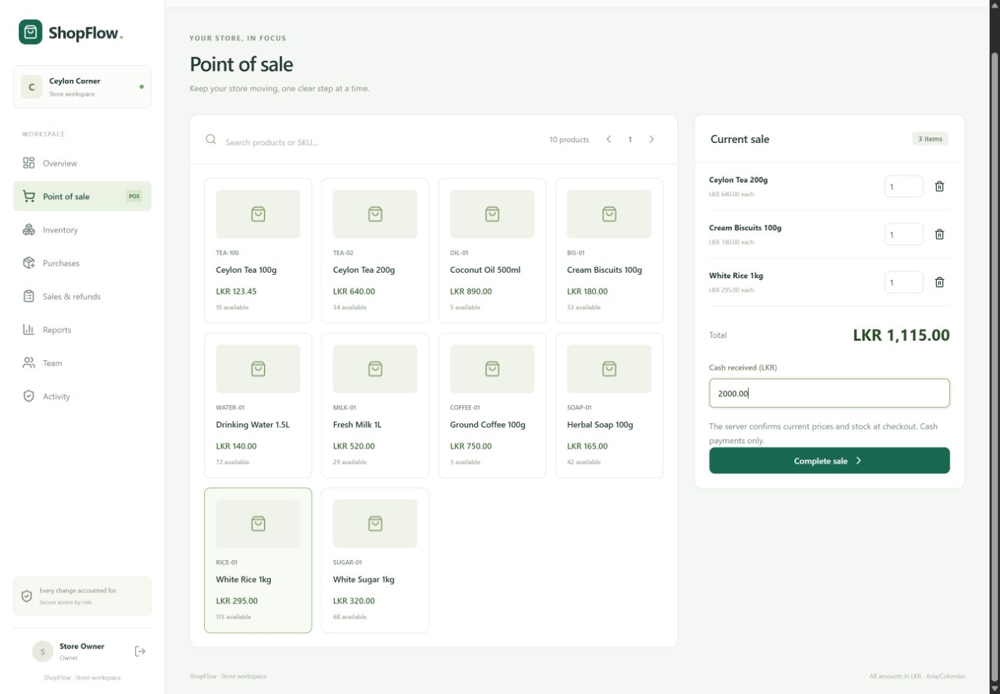
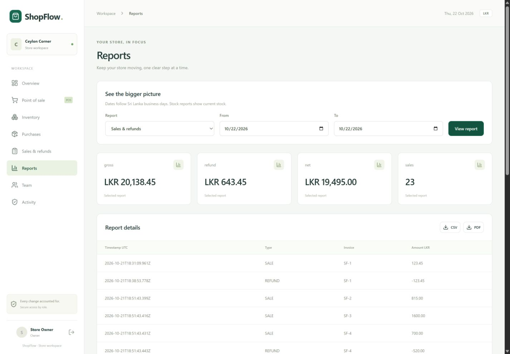
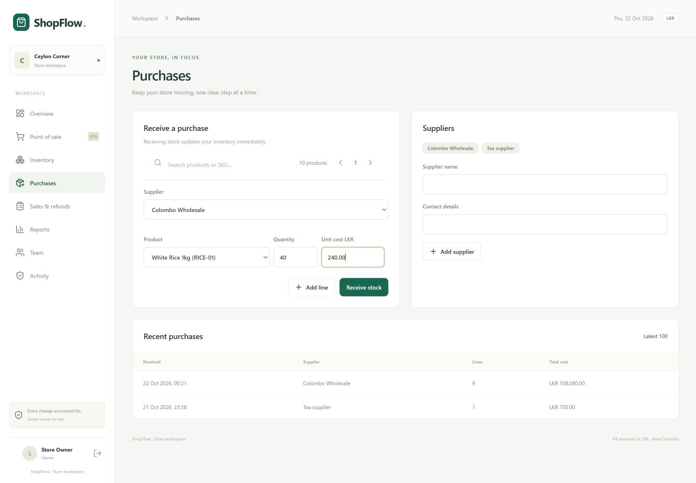
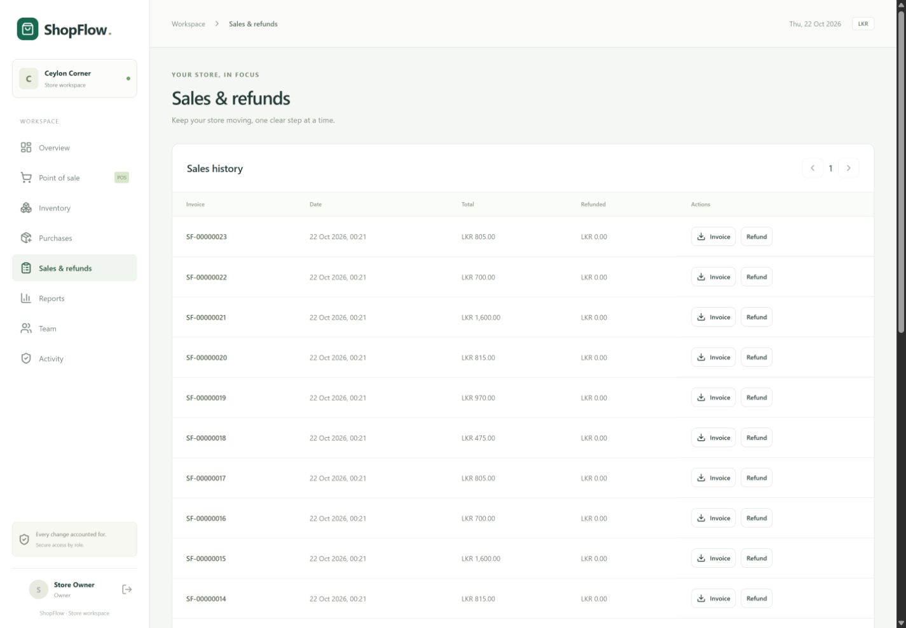
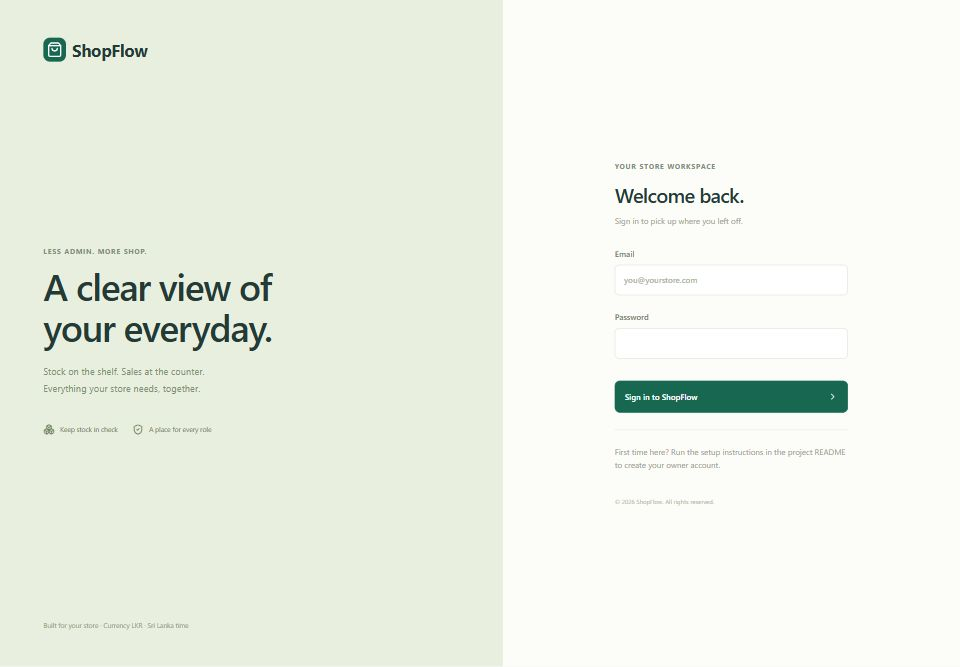
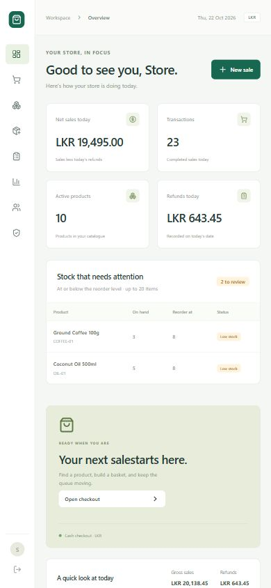
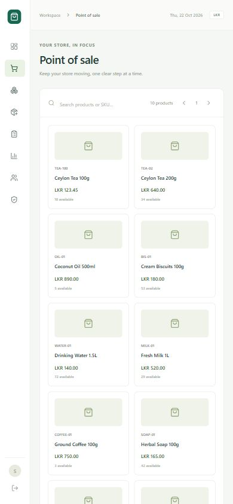

# ShopFlow screenshot gallery

These are real browser captures of the working local application with fictional sample data. The sample store is **Ceylon Corner** and the signed-in display name is **Store Owner**. The app itself has no fixed author name in the dashboard. The sign-in fields are empty; no passwords, session tokens, private contacts or real customer records are shown.

Use the original JPEG files below in a portfolio, case study or project presentation. The source package contains the same gallery locally. The sample database and its login credentials are not included.

## Desktop

### Store dashboard

Daily sales totals, refund totals, low-stock alerts and a checkout shortcut.

### Inventory

Products, categories, prices, unit costs, stock levels and reorder status.

### Point of sale

Product selection, a three-item basket, exact LKR totals and cash received. This screenshot shows a basket before confirmation.

### Sales reports

Sri Lanka date filters, gross sales, refunds, net sales and CSV/PDF export options.

### Purchasing

Supplier selection, purchase receipt entry and recent purchase history.

### Sales and refunds

Invoice history, recorded refund totals, PDF downloads and permission-controlled refund actions.

### Sign-in

The default sign-in screen with empty credential fields and generic ShopFlow branding.

## Mobile

Narrow responsive layouts for the dashboard and product catalogue. Original images are 390 pixels wide.

| Dashboard                                             | Point of sale                                       |
| ----------------------------------------------------- | --------------------------------------------------- |
|  |  |

## Refreshing the gallery after a change

1. Run an isolated local preview with fictional data. Keep real customer and business information out of screenshots.
2. Update the relevant screen, wait for loading to finish and capture the actual browser view.
3. Replace the matching JPEG file, keeping its filename so README links continue to work. Keep credential fields empty in sign-in images.
4. Inspect each image for layout problems and private information, then copy reviewed images into the separate GitHub clone and commit them.

Project author and owner: **tniketha**. Third-party packages retain their own licenses.
